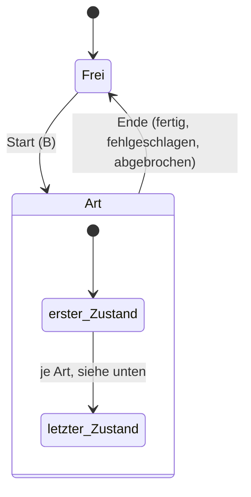
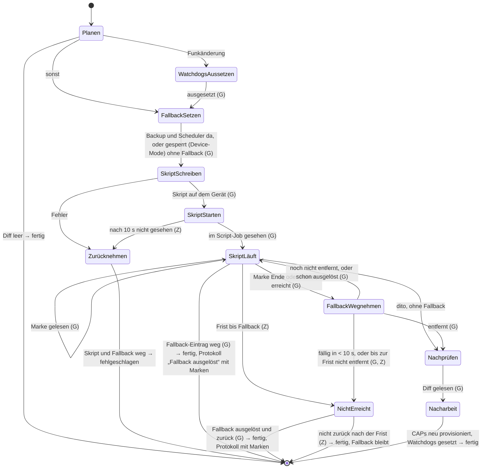
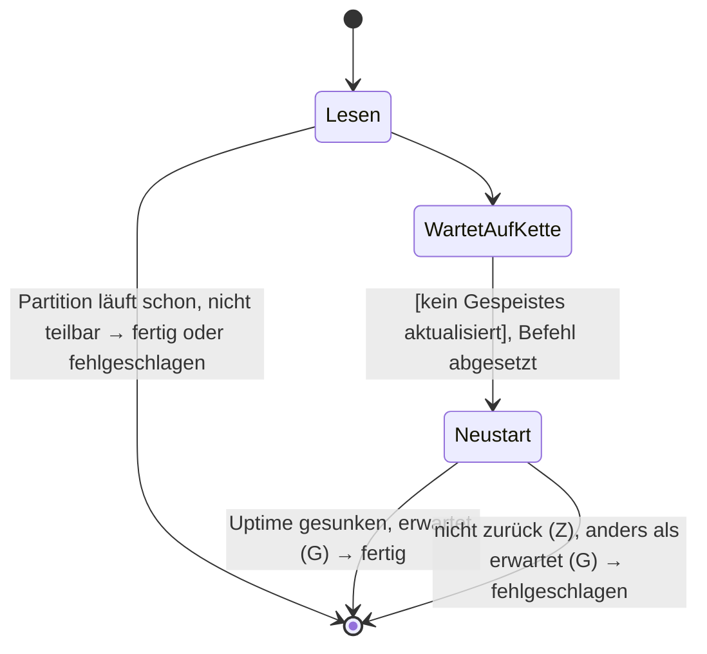
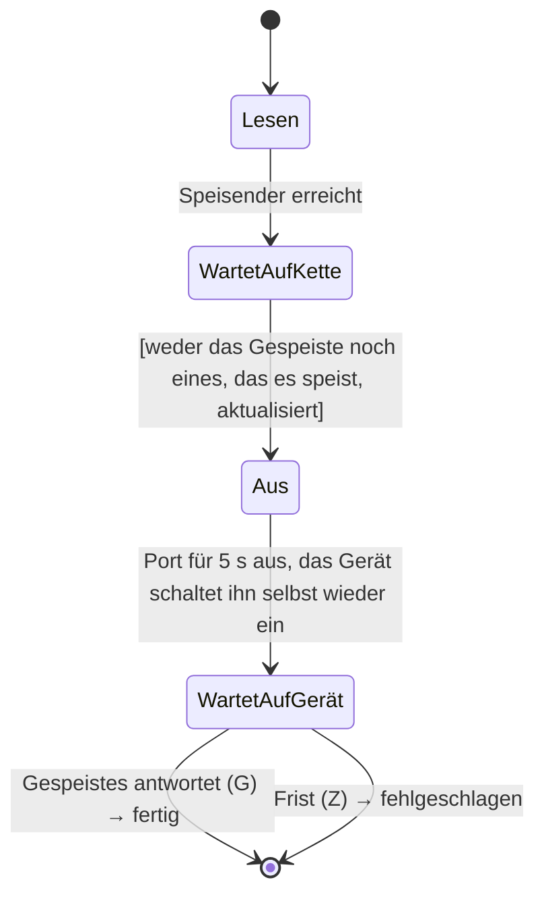
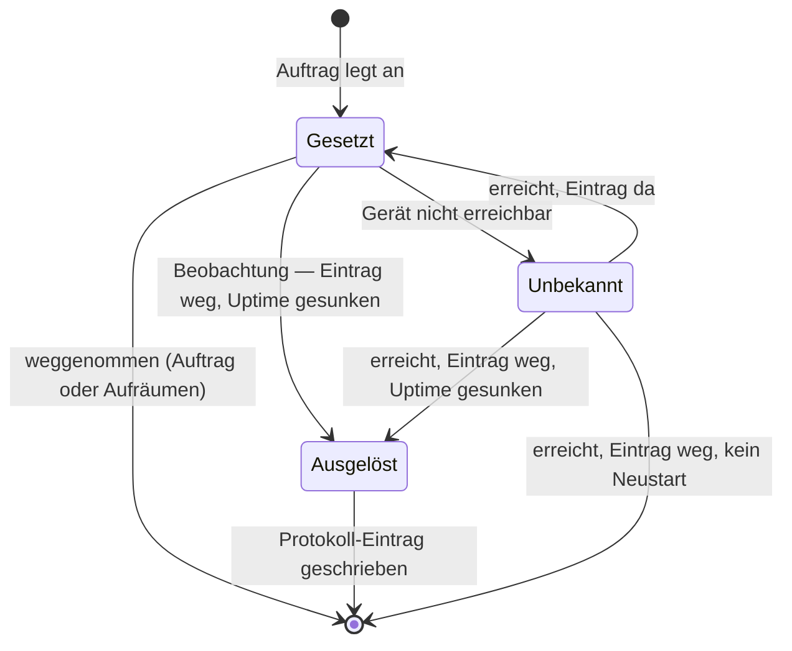
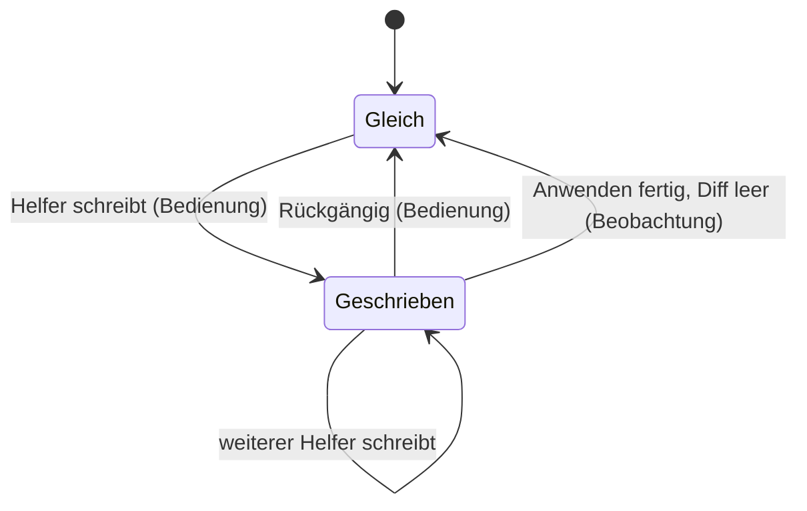

# Konzept: Zustand eines Geräts als State-Machine

Status: Entwurf, nichts davon umgesetzt. Beginn von D5 (Jobs über Neustarts, geordnetes Beenden);
ersetzt dort den Teil „Events speichern“ von [Jobs](job-polling.md#vorschlag).

## Warum

Was der Provisioner über ein Gerät weiss, liegt heute an vier Stellen, und keine davon überlebt
einen Neustart des Servers:

- **Jobs** im Speicher (`job::JOBS`): was läuft, mit seinen Events. Nach einem Neustart weg.
- **Leases** in `device::power` (Update, Neustart, Strom aus und ein): wer auf wen wartet. Im
  Speicher.
- **Rückgängig** eines NetBox-Schreibens (`NetboxWritten.before`): im Event des Jobs, also auch
  im Speicher.
- **Was auf dem Gerät von selbst auslöst** (Fallbacks, Sicherheitsnetz der Watchdogs, Pakete): nur auf
  dem Gerät. `device::leftovers` findet es erst, wenn jemand die Seite öffnet, und weiss nicht,
  welcher Auftrag es hinterlassen hat und warum.

Der Ablauf eines Auftrags steckt im Code des Jobs (`update.rs`, `apply`, `batch.rs`), als Folge
von `await`s. Wo er gerade steht, sieht man nur an seinen Events. Bricht der Prozess ab, ist auch
das weg.

Ziel: Pro Gerät **ein Zustand**, der ausdrücklich modelliert ist, gespeichert wird und den nur
klar benannte Übergänge ändern. Ein Job ist dann der Treiber, der Übergänge auslöst, nicht mehr
der Ort, an dem der Zustand lebt.

## Grundsätze

1. **Kein Eintrag heisst Ruhe.** Ein Gerät ohne gespeicherten Zustand ist im Grundzustand: Kein
   Auftrag läuft, auf dem Gerät wartet kein Selbstauslöser des Provisioners, nichts ist in NetBox
   geschrieben und noch nicht angewendet. Das ist der Normalfall für fast alle Geräte.
2. **Ein Eintrag bleibt, solange etwas offen ist.** Er wird erst gelöscht, wenn jeder Teilzustand (siehe
   unten) wieder im Grundzustand ist. Ein Auftrag, der fertig ist, aber einen Fallback auf dem
   Gerät hinterlässt, ist nicht fertig im Sinn des Zustands.
3. **Übergänge nur durch Eingaben.** Es gibt genau zwei Quellen:
   - **Bedienung**: ein Mensch startet, bricht ab oder räumt auf.
   - **Beobachtung**: der Provisioner liest am Gerät (oder an NetBox), was ist: erreichbar, Uptime
     gesunken, Marke des Skripts, Scheduler-Eintrag weg, Version, OSPF-Nachbarn.

   Dazu kommen zwei Ereignisse des Servers selbst: **Start** (gespeicherte Zustände einlesen) und
   **Ablauf einer Frist** (z.B. „nach 25 s keine Antwort“). Beide sind Beobachtungen der Zeit.
4. **Beobachten ist automatisch, Reparieren nicht.** Der Provisioner darf jederzeit lesen und den
   Zustand nachführen. Etwas am Gerät ändern darf nur ein Übergang, den ein Mensch ausgelöst hat,
   oder der laufende Auftrag, den ein Mensch gestartet hat (siehe
   [Speicher](#speicher-nur-fürs-weiterführen) zum Weiterführen nach einem Neustart).
5. **Was geschehen ist, steht im Protokoll, nicht im Zustand.** Der Zustand sagt nur, was noch
   läuft oder noch wirken kann. Das Ende eines Auftrags (fertig, fehlgeschlagen, abgebrochen,
   unterbrochen), ein ausgelöster Fallback oder ein teilweise geschriebener Plan sind
   [Protokoll](#protokoll)-Einträge; der Zustand ist danach wieder im Grundzustand.
6. **Gespeichert wird bei jedem Übergang**, bevor die Wirkung beginnt: Erst „Fallback wird
   gesetzt“ schreiben, dann den Scheduler anlegen. So weiss der Server nach einem Absturz,
   dass dort vielleicht ein Scheduler liegt, und schaut nach.

## Teilzustände

Ein Gerät hat drei Dinge, die unabhängig voneinander laufen: Ein Selbstauslöser bleibt, wenn der
Auftrag, der ihn gesetzt hat, längst zu Ende ist, und liegt manchmal auf einem anderen Gerät; was
in NetBox geschrieben ist, wartet auf ein Anwenden, das vielleicht nie kommt. Statt eines Zustands
mit allen Kombinationen hat es **Teilzustände**, jeder mit einer eigenen kleinen State-Machine (in UML
heissen sie orthogonale Regionen). Der Eintrag ist leer, wenn alle Teilzustände im
Grundzustand sind.

| Teilzustand | Grundzustand | Worum es geht |
|---|---|---|
| **Auftrag** | `Frei` | was der Provisioner gerade auf dem Gerät tut |
| **Selbstauslöser** | leer | was auf dem Gerät von selbst handelt, wenn niemand es vorher wegnimmt: Apply-Fallback, Update-Fallback, Sicherheitsnetz der Watchdogs, hochgeladene Pakete |
| **NetBox** | `Gleich` | in NetBox geschrieben, aber noch nicht angewendet, mit den Daten für Rückgängig |

Die Teilzustände sprechen sich nur über Ereignisse ab: Der Auftrag „Anwenden“ legt im Zustand
`FallbackSetzen` einen Eintrag in **Selbstauslöser** an; der Auftrag endet, der Eintrag bleibt, bis eine
Beobachtung ihn wegnimmt.

Nicht unabhängig sind die Leases der PoE-Kette (heute `device::power`) und das gemeinsame
Anwenden: Sie folgen aus den Aufträgen mehrerer Geräte und sind deshalb **Bedingungen an
Übergängen**, kein eigener Teilzustand (siehe [Bedingungen über Geräte
hinweg](#bedingungen-über-geräte-hinweg)).

## Teilzustand „Auftrag“

Höchstens ein Auftrag pro Gerät (wie heute). Ein Auftrag einer Site (`SiteDiff`) liest nur und hat
keinen Gerätezustand. Jede Art (`JobKind`) ist eine **eigene State-Machine**: Die Zustände eines
Updates haben mit denen eines Anwendens nichts gemein. Gemeinsam ist nur der Rahmen.

### Rahmen

Für jede Art gilt:
- **Start** ist immer eine Bedienung (B). Was beim Start schon entschieden ist, gehört zum Start
  und ist kein Zustand: die Version eines Updates, „ohne Weg zurück bestätigt“ (Z23), die MAC der
  Ersteinrichtung.
- **Ende** ist einer von drei Ausgängen (fertig, fehlgeschlagen, abgebrochen) und schreibt einen
  Protokoll-Eintrag mit dem Zustand, in dem der Auftrag endete. Danach ist er `Frei`.
- **Abbrechen** (B) wirkt nur in Zuständen, die es erlauben (in den Diagrammen *abbrechbar*); in
  den anderen läuft der Zustand zu Ende, dann gilt der Abbruch.
- **Server gestartet**: Für jeden Zustand steht fest, was dann geschieht: *weiterführen* (nur
  wo das Ende eine gelungene Änderung zurücknähme, siehe
  [Speicher](#speicher-nur-fürs-weiterführen)) oder *unterbrochen* (Ende, die Selbstauslöser
  bleiben auf dem Gerät).

Die Übergänge sind mit ihrer Quelle bezeichnet: **(B)** Bedienung, **(G)** Beobachtung am Gerät,
**(Z)** Frist abgelaufen. Eine Bedingung über andere Geräte steht in eckigen Klammern, z.B.
`[kein Speisendes startet neu]`.

### Anwenden

**Wofür:** bringt die Konfiguration des Geräts auf das, was der Generator aus NetBox erzeugt
(`applyCfg`). Was danach im Diff übrig bleibt, ist das, was nicht ging.

**Beachtet:**
- Das Skript läuft **auf dem Gerät** im Hintergrund, damit es fertig wird, auch wenn es den Weg
  der Verbindung ändert. Es hält beim ersten Fehler an.
- Vorher sichert das Gerät ein Backup und plant dessen Laden (Skript-Limit 120 s plus
  `apply_fallback_seconds`). Das Ende des Skripts zieht den Fallback auf die Frist ab dann vor.
- Gezählt wird nach der **Uptime** des Geräts, nicht nach seiner Uhr: Ein NTP-Sprung nach dem
  Anwenden liess einen Fallback sofort fällig aussehen (1og-sw1).
- Das Skript schreibt **Marken** unter `flash/` (Menü begonnen, Ende oder Fehlerzeile, Ping zum
  Provisioner weg/zurück). Sie überdauern den Neustart des Fallbacks und sagen, wo es abriss.
- Innerhalb von 10 s vor dem Auslösen wird der Fallback nicht mehr weggenommen (`DUE`).
- Eine Funkänderung verlängert die Frist um 24 min (DFS-Kanäle hören vorher auf Radar) und setzt
  die Watchdogs der abhängigen Geräte aus.
- Jede Prüfung nach dem Skript hat 25 s, damit eine kurz wieder offene Funkstrecke nicht
  verpasst wird.
- Sperrt der Device-Mode den Scheduler, geht es ohne Fallback (`FallbackUnavailable`).
- Ändert das Anwenden die WLANs eines Controllers, provisioniert es danach die CAPs neu.

**Bewusst nicht:**
- Ein gestartetes Skript wird nie angehalten, auch nicht beim Abbrechen; das entscheidet der
  Mensch.
- Ein Gerät ohne Marken (Datei nicht schreibbar) gilt nach 90 s als durch, wie vor den Marken.
- Die Reihenfolge eines Rollouts (vom Management-Proxy nach aussen, z.B. bei MTU) ist Sache des
  Menschen, nicht des Auftrags.

Umgesetzt als `device_state::ApplyState` (Name im Code in Klammern); das einzelne und das
gemeinsame Anwenden melden ihre Zustände daran.

| Zustand | abbrechbar | Server gestartet | Selbstauslöser |
|---|---|---|---|
| `Planen` (`Planning`) | ja, Ende | unterbrochen | – |
| `WatchdogsAussetzen` (`SuspendingWatchdogs`) | ja, Watchdogs zurück | unterbrochen | + Sicherheitsnetz (bei den Überwachenden) |
| `FallbackSetzen` (`ArmingFallback`) | ja, Fallback weg | unterbrochen, Fallback beobachten | + Apply-Fallback |
| `SkriptSchreiben` (`WritingScript`) | ja, Fallback weg | unterbrochen | – |
| `SkriptStarten` (`StartingScript`) | nach dem Zustand | unterbrochen | + Apply-Skript |
| `Zurücknehmen` (`TakingBack`) | nach dem Zustand | unterbrochen | − Apply-Fallback |
| `SkriptLäuft` (`ScriptRunning`) | ja, Fallback bleibt | weiterführen | – |
| `FallbackWegnehmen` (`StoppingFallback`) | nach dem Zustand | weiterführen | − Apply-Fallback |
| `NichtErreicht` (`NotReached`) | ja, Fallback bleibt | unterbrochen | – |
| `Nachprüfen` (`Checking`) | ja, Ende | unterbrochen | – |
| `Nacharbeit` (`Finishing`) | nach dem Zustand | unterbrochen | − Sicherheitsnetz |

Beim Umsetzen korrigiert: Die Watchdogs werden **vor** dem Fallback ausgesetzt, nicht danach;
„zurückgeladen“ ist kein Zustand, sondern ein Ende (der Auftrag liest die Marken und endet).

**Gemeinsam anwenden** ist ein Anwenden pro Gerät, deren Machines über Bedingungen aufeinander
warten (siehe [Bedingungen über Geräte hinweg](#bedingungen-über-geräte-hinweg)).

### Update

**Wofür:** bringt RouterOS auf den neuesten Stand des gewählten Kanals, die Pakete auf das, was
NetBox braucht, und danach die RouterBOARD-Firmware (`updateRouteros`).

**Beachtet:**
- RouterOS 6 geht zuerst auf das neueste v6, dann auf v7.
- Pakete: `routeros` plus das Funkpaket, das NetBox braucht; `wireless` bleibt, wo ein
  Legacy-CAPsMAN läuft, den NetBox nicht kennt. Alles andere wird deinstalliert.
- Alle Pakete eines Schritts werden heruntergeladen, bevor das erste hochgeht, und entfernt,
  wenn der Auftrag vor dem Neustart endet: ein Teil davon darf nicht irgendwann installieren.
- Hochladen über SCP; dafür wird `/ip ssh` kurz auf Passwort-Login gestellt. Danach wird die
  Grösse geprüft (16-MB-Geräte haben den Root im RAM).
- Ein Neustart gilt als erkannt, wenn die Uptime sinkt, nicht wenn die Verbindung abreisst.
- **Erfolg** heisst: erwartete Version *und* alle OSPF-Nachbarn von vorher wieder benachbart
  (`Full`, oder `TwoWay` zwischen zwei DROther).
- Fallback: die alte Partition samt Konfiguration kopieren, ein Scheduler bootet sie, wenn der
  Auftrag sie nicht rechtzeitig wegnimmt.
- Die Watchdogs der Geräte, die dieses überwachen, werden ausgesetzt; ihr Sicherheitsnetz setzt
  sie nach 2 h selbst wieder.
- PoE-Kette: siehe [Bedingungen](#poe-kette).
- Alte Geräte: MD5-Login vor 6.43, v6-SSH-Algorithmen, Board-Namen ohne `RB`.

**Bewusst nicht:**
- Für die Firmware gibt es keinen Weg zurück (nur der Backup-Booter vor Ort).
- RouterOS 6 und Geräte ohne zwei Partitionen haben keinen Fallback; das bestätigt der Mensch
  beim Start (Z23).
- Updates, die nicht dieser Provisioner startet, sieht die PoE-Kette nicht.

Umgesetzt als `device_state::UpdateState`, zusammen mit dem Downgrade (Name im Code in
Klammern).

```mermaid
stateDiagram-v2
    [*] --> Lesen
    Lesen --> WatchdogsAussetzen: Überwachende vorhanden, bestätigt
    Lesen --> WartetAufKette: sonst
    WatchdogsAussetzen --> WartetAufKette
    WartetAufKette --> NachbarnMerken: [kein Speisendes startet neu], Schritt nötig
    WartetAufKette --> Firmware: [kein Speisendes startet neu], RouterOS und Pakete stimmen, Firmware alt
    WartetAufKette --> [*]: dito, Firmware aktuell → fertig
    NachbarnMerken --> FallbackSetzen
    FallbackSetzen --> Laden: alte Partition kopiert, Scheduler da, oder ohne Weg zurück bestätigt (G)
    Laden --> Hochladen: alle Pakete des Schritts heruntergeladen
    Hochladen --> WartetAufNeustart: alle Pakete auf dem Gerät (G)
    WartetAufNeustart --> Neustart: [kein Gespeistes aktualisiert]
    Neustart --> Laden: Version richtig, weiterer Schritt (v6 → v7) (G)
    Neustart --> FallbackWegnehmen: Version richtig, letzter Schritt (G)
    Neustart --> NachbarnWarten: dito, ohne Fallback (RouterOS 6)
    FallbackSetzen --> NichtAktualisiert: Fehler
    Laden --> NichtAktualisiert: Fehler, Abbruch
    Hochladen --> NichtAktualisiert: Fehler, Abbruch → Pakete weg
    WartetAufNeustart --> NichtAktualisiert: Abbruch → Pakete weg
    Neustart --> NichtAktualisiert: alte Partition läuft, nicht zurück (Z), andere Version (G)
    NichtAktualisiert --> [*]: fehlgeschlagen; zurückgerollt, oder erreicht und Fallback weg
    FallbackWegnehmen --> NachbarnWarten
    NachbarnWarten --> Firmware: alle gemerkten Nachbarn benachbart, Firmware alt (G)
    NachbarnWarten --> [*]: dito, Firmware aktuell → fertig; Frist (Z) → fehlgeschlagen
    Firmware --> WartetAufFirmwareNeustart: Upgrade gesetzt
    WartetAufFirmwareNeustart --> FirmwareNeustart: [kein Gespeistes aktualisiert]
    FirmwareNeustart --> [*]: neue Firmware läuft (G) → fertig
```

Nach jedem Zustand, auch nach einem Fehler: `WatchdogsZurück` (`RestoringWatchdogs`), wo
welche ausgesetzt sind. Ohne Fallback (kein Weg zurück) gibt es `NichtAktualisiert` nicht: Ein
Fehler endet direkt.

| Zustand | abbrechbar | Server gestartet | Selbstauslöser |
|---|---|---|---|
| `Lesen` (`Reading`) | ja, Ende | unterbrochen | – |
| `WatchdogsAussetzen` (`SuspendingWatchdogs`) | nach dem Zustand | unterbrochen | + Sicherheitsnetz (bei den Überwachenden) |
| `WartetAufKette` (`WaitingForChain`), `NachbarnMerken` (`RememberingNeighbors`) | ja, Ende | unterbrochen | – |
| `FallbackSetzen` (`ArmingFallback`) | nach dem Zustand | unterbrochen, Fallback beobachten | + Update-Fallback |
| `Laden` (`Downloading`) | ja, Fallback weg | unterbrochen | – |
| `Hochladen` (`Uploading`), `WartetAufNeustart` (`WaitingToReboot`) | ja, Pakete und Fallback weg | unterbrochen, Pakete beobachten | + Pakete |
| `Neustart` (`Rebooting`) | nach dem Zustand | weiterführen, wenn ein Fallback gesetzt ist | − Pakete (installiert) |
| `NichtAktualisiert` (`NotUpdated`) | nach dem Zustand | weiterführen | − Update-Fallback, wenn erreicht |
| `FallbackWegnehmen` (`StoppingFallback`) | nach dem Zustand | weiterführen | − Update-Fallback |
| `NachbarnWarten` (`WaitingForNeighbors`) | ja, Ende | unterbrochen | – |
| `Firmware`, `FirmwareNeustart` (`RebootingFirmware`) | nach dem Zustand | unterbrochen | – |
| `WartetAufFirmwareNeustart` (`WaitingToRebootFirmware`) | ja, Ende | unterbrochen | – |
| `WatchdogsZurück` (`RestoringWatchdogs`) | nach dem Zustand | unterbrochen | − Sicherheitsnetz |

Beim Umsetzen korrigiert: Die Watchdogs werden vor dem Warten auf die Kette ausgesetzt; der
Fehler mit gesetztem Fallback ist ein eigener Zustand (`not_updated`: zurückgerollt erkennen
oder den Fallback wegnehmen), nicht nur „alte Partition läuft“.

Die Watchdogs, die das Gerät überwachen, setzt der Auftrag vor dem Update auf den **anderen**
Geräten aus (`Watchers`) und danach wieder; deren Sicherheitsnetz ist ein Selbstauslöser bei
**jenen** Geräten, mit Verweis auf diesen Auftrag. Ein Fehler mit gesetztem Fallback, bei dem die
alte Partition nicht läuft, nimmt den Fallback weg (`not_updated`).

### Downgrade

**Wofür:** die Rettung nach einem Update, das zwar läuft, aber Probleme macht: dieselben Pakete
in einer älteren Version (`downgradeRouteros`), vorbelegt mit der Version vor dem letzten Update.

**Beachtet:**
- Hochladen wie beim Update, dann `/system/package/downgrade`, das selbst neu startet.
- Auf die andere Partition wird nichts kopiert: Sie hält vielleicht genau den Weg zurück.
- Ein Gerät ohne zwei Partitionen braucht die Bestätigung beim Start (`check_downgrade`).

**Bewusst nicht:** die Firmware zurückstellen.

Dieselbe Machine wie das Update, ohne Fallback und Firmware:

```mermaid
stateDiagram-v2
    [*] --> Lesen
    Lesen --> WatchdogsAussetzen: Überwachende vorhanden, bestätigt
    Lesen --> WartetAufKette: sonst
    Lesen --> [*]: keine ältere Version von RouterOS 7 → fehlgeschlagen
    WatchdogsAussetzen --> WartetAufKette
    WartetAufKette --> NachbarnMerken: [kein Speisendes startet neu]
    NachbarnMerken --> Laden: zweite Partition, Nachbar oder bestätigt
    NachbarnMerken --> [*]: kein Weg zurück → fehlgeschlagen
    Laden --> Hochladen
    Hochladen --> WartetAufNeustart: Pakete auf dem Gerät (G)
    WartetAufNeustart --> Neustart: [kein Gespeistes aktualisiert], Downgrade ausgelöst
    Neustart --> NachbarnWarten: ältere Version läuft (G)
    Neustart --> [*]: abgelehnt → Pakete weg; nicht zurück (Z) → fehlgeschlagen
    NachbarnWarten --> [*]: Nachbarn da (G) → fertig
```

Selbstauslöser: Pakete ab `Hochladen`, weg mit dem `Neustart`.

### Neustart, Partitionieren, Partition booten

**Wofür:**
- **Neustart:** „Neu starten“ auf der Geräteseite, mit Rückfrage (`rebootDevice`).
- **Partitionieren:** teilt den Flash in zwei Partitionen, die Voraussetzung für den Fallback
  des Updates (`repartitionDevice`; ab RouterOS 7.20, mindestens 128 MiB, Device-Mode
  `partitions`).
- **Partition booten:** startet von der anderen Partition, z.B. zurück auf die vor dem Update
  (`bootPartition`).

**Beachtet:** Alle drei warten wie ein Update auf die PoE-Kette und erkennen den Neustart an der
Uptime.

**Bewusst nicht:** ein Kaltstart; dafür gibt es „Strom aus und ein“.

Umgesetzt als `device_state::RebootState`:

„Erwartet“ heisst beim Partitionieren zwei Partitionen und dieselbe Identity, beim Booten die
gewählte Partition. Abbrechbar bis `WartetAufKette`; nach einem Start des Servers: unterbrochen.

### Strom aus und ein

**Wofür:** startet ein über PoE gespeistes Gerät kalt (`powerCycle`): ein hängendes Gerät, oder
die Bestätigung einer Device-Mode-Änderung, die ein warmer Neustart nicht gibt.

**Beachtet:**
- Der Port des Speisenden wird über seinen Werksnamen gefunden und 5 s ausgeschaltet.
- Ein Auftrag des Speisenden, damit er neben dem eigenen Auftrag des Geräts laufen kann (die
  Device-Mode-Änderung wartet ja gerade auf ihn).
- Er wartet, solange das Gerät oder eines, das es speist, Pakete installiert.

**Bewusst nicht:** Der Provisioner startet ihn nie von selbst.

Ein Auftrag des **Speisenden**, der den Strom eines anderen Geräts schneidet. Beim gespeisten
Gerät ist dafür kein eigener Zustand nötig: Ob ihm gerade der Strom geschnitten wird, folgt aus
dem Auftrag seines Speisenden.

Umgesetzt als `device_state::PowerCycleState`:

Die Bedingung `[kein Speisendes startet neu]` gilt für das Gespeiste bis zum Ende von
`WartetAufGerät`, nicht nur bis zum Befehl (beim Umsetzen gefunden und behoben).

### Device-Mode

**Wofür:** schaltet Features ein, die der Provisioner braucht und die der Device-Mode sperrt
(`changeDeviceMode`): den Scheduler für den Apply-Fallback, `/ip socks` auf dem Gerät des
Management-Proxys, `partitions` für den Update-Fallback.

**Beachtet:**
- RouterOS übernimmt die Änderung nur nach einer Bestätigung **am Gerät** (Taste oder Kaltstart)
  innerhalb von 10 min; ein warmer Neustart bestätigt nicht.
- Die Verbindung muss offen bleiben, solange das Gerät zählt; schliesst sie, bricht RouterOS ab.
- Gesendet werden nur Features, die aus sind: Auch eine Änderung ohne Wirkung zählt herunter.

**Bewusst nicht:** andere Features des Device-Mode.

Umgesetzt als `device_state::DeviceModeState`:

```mermaid
stateDiagram-v2
    [*] --> Lesen
    Lesen --> [*]: alles schon an → fertig
    Lesen --> WartetAufKette: Features fehlen
    WartetAufKette --> Anfordern: [kein Gespeistes aktualisiert]
    Anfordern --> WartetAufTaste: Update gesendet, Gerät zählt (G)
    Anfordern --> [*]: abgelehnt (G) → fehlgeschlagen
    WartetAufTaste --> Neustart: Gerät geht weg (G) — Taste oder Kaltstart (B am Gerät)
    WartetAufTaste --> [*]: „update canceled“ nach 10 min (Z) → fehlgeschlagen
    Neustart --> [*]: Features an (G) → fertig; Frist (Z) → fehlgeschlagen
```

Die Bestätigung ist eine Bedienung **am Gerät**, nicht im Provisioner; der Auftrag beobachtet nur,
dass das Gerät weggeht. `WartetAufTaste` hält die Verbindung offen, sonst bricht RouterOS ab:
Nach einem Start des Servers ist die Änderung deshalb sicher weg, also *unterbrochen*, ohne
Selbstauslöser. Auch `Neustart` endet als unterbrochen: er liest nur.

### Ersteinrichtung

**Wofür:** richtet ein Gerät ein, das nicht antwortet (Werkszustand, verlorene Adresse), über
`/tool mac-telnet` von einem Nachbarn aus, der antwortet (`bootstrap`): Passwort, Adresse, API,
eine Firewall-Freigabe.

**Beachtet:**
- Das Gerät wird über die MAC gewählt, die der Nachbar an diesem Port sieht oder die der Mensch
  eintippt, **nie über eine MAC aus NetBox**.
- Die Konsole des Nachbarn läuft über SSH; vorher wird geprüft, dass er SSH-Weiterleitung
  erlaubt, sonst bleibt alles unberührt.
- `mac-telnet` mit und ohne `interface=` (je nach Gerät antwortet nur eine Variante).
- Ein spät antwortendes Gerät lässt Logins scheitern oder Sitzungen abbrechen: Jede Anmeldung
  wird bis zu einer Frist wiederholt, nach einem Abbruch laufen alle Befehle noch einmal (jeder
  tut nichts, wo er schon gilt).
- Endet die Sitzung früh, landen Befehle auf der Konsole des Nachbarn; jeder Befehl tut dort
  nichts (`netboxProvisionerNeighbor`).
- Ein DHCP-Client, der die Adresse hält, wird ausgeschaltet; der CAP eines Heim-APs nur nach
  einem Werks-Login.

**Bewusst nicht:** die eigentliche Konfiguration; die bringt das erste Anwenden.

Umgesetzt als `device_state::BootstrapState`:

```mermaid
stateDiagram-v2
    [*] --> NachbarPrüfen: [Nachbar ohne Auftrag]
    NachbarPrüfen --> [*]: Weiterleitung aus → fehlgeschlagen
    NachbarPrüfen --> Konsole: SSH zum Nachbarn, mac-telnet (G)
    Konsole --> WartetAufApi: Einrichtung durch (G); Logins bis zur Frist wiederholt
    Konsole --> [*]: kein Login bis zur Frist (Z) → fehlgeschlagen
    WartetAufApi --> [*]: API antwortet (G) → fertig
    WartetAufApi --> [*]: Frist (Z) → fehlgeschlagen
```

Läuft über ein anderes Gerät (den Nachbarn), das solange keinen eigenen Auftrag annimmt
(`job::start_through`): eine Bedingung über Geräte hinweg, und umgekehrt kein Auftrag des
Nachbarn, solange die Ersteinrichtung läuft. In `Konsole` nicht abbrechbar; nach einem Start des
Servers ist die Sitzung weg, also *unterbrochen*. Sie hinterlässt beim Nachbarn nichts, was
selbst auslöst (die Befehle tun dort nichts, `netboxProvisionerNeighbor`).

### Aufräumen

**Wofür:** nimmt einen Selbstauslöser weg, den ein Auftrag nicht zu Ende gebracht hat
(`clearLeftover`): Fallback stoppen oder jetzt laden, Update-Fallback stoppen, Watchdogs jetzt
wiederherstellen, Pakete entfernen.

**Beachtet:** Nichts davon geschieht von selbst; ein schon weggeräumter Eintrag ist ein Fehler
(`LEFTOVER_GONE`), kein stilles Nichtstun.

**Bewusst nicht:** das Apply-Skript, solange es läuft (es endet selbst), und eine
Device-Mode-Änderung (die bleibt nie liegen).

Umgesetzt als `device_state::CleanupState`: `Wegräumen` (`Clearing`), dann Ende; „Jetzt
zurück“ hat danach `Neustart` (`Rebooting`), bis das Gerät mit der Konfiguration von vorher
zurück ist; davor `WartetAufKette` (`WaitingForChain`), `[kein Gespeistes aktualisiert]` wie bei
jedem Neustart (beim Umsetzen gefunden und behoben). Wirkt auf **Selbstauslöser** (der gewählte
Eintrag weg).

### NetBox schreiben, zurücknehmen

**Wofür:** schreibt den Plan eines Helfers nach NetBox (`writeNetboxPlan`) oder nimmt ein solches
Schreiben zurück (`undoNetboxWrite`).

**Beachtet:**
- Der Plan wird neu berechnet und abgelehnt, wenn sein Fingerabdruck sich geändert hat; vor jedem
  Schritt wird geprüft, dass NetBox noch so ist, wie der Plan es fand.
- Jedes geschriebene Objekt hält seine alten Werte, damit Rückgängig sie rückwärts wieder setzt;
  Gelöschtes wird neu angelegt (mit neuer Id).
- Jede Änderung trägt eine Changelog-Nachricht mit Plan und Benutzer; danach wird die Topologie
  neu gelesen.

**Bewusst nicht:** eine Transaktion. NetBox hat keine über mehrere Objekte, ein Fehler mitten im
Plan lässt den Teil davor geschrieben (`poe_type` an koenig-hegglin).

Umgesetzt als `device_state::NetboxState`: `Planen` (`Planning`, Plan neu berechnet und mit
dem gezeigten verglichen), `Schreiben` (`Writing`, Schritt um Schritt) bzw. `Zurücknehmen`
(`Undoing`), danach in jedem Fall `NeuLesen` (`Refetching`, die Topologie). Wirkt auf **NetBox**:
Jeder geschriebene Schritt kommt sofort dazu, auch wenn ein späterer fehlschlägt. Nach einem Start
des Servers: unterbrochen, `Geschrieben` hält, was durchging.

## Bedingungen über Geräte hinweg

Zwei Dinge hängen an den Aufträgen **mehrerer** Geräte. Sie sind keine Zustände, sondern
Bedingungen, die ein Übergang über die Auftrag-Zustände der anderen prüft. Gespeichert werden
muss dafür nichts Eigenes: Nach einem Neustart des Servers folgen sie aus den gespeicherten
Aufträgen.

### PoE-Kette

Ein Gerät, das gerade Pakete auf dem Flash hat, kann ein Stromausfall unbrauchbar machen. Heute
schützen das die Leases in `device::power`; als Bedingungen:

| Bedingung | wahr, wenn kein Gerät der Kette … |
|---|---|
| `[kein Gespeistes aktualisiert]` | … unterhalb (das es direkt oder weiter unten speist) in einem Update oder Downgrade nach `WartetAufKette` ist |
| `[kein Speisendes startet neu]` | … oberhalb neu startet (`Neustart`, `Ausgelöst`, `FirmwareNeustart`, Device-Mode `WartetAufTaste` und `Neustart`) oder einem Gerät darunter den Strom schneidet („Strom aus und ein“ `Aus`, `WartetAufGerät`) |
| `[weder das Gespeiste noch eines, das es speist, aktualisiert]` | … ab dem gespeisten Gerät abwärts in einem Update oder Downgrade nach `WartetAufKette` ist |

Wer auf eine Bedingung wartet, bleibt im Zustand `WartetAuf…`; der Übergang geschieht, sobald ein
anderes Gerät seinen Zustand ändert. Prüfen und Übergang geschehen unter einer Sperre, damit sich
zwei Geräte nicht kreuzen (wie heute `acquire`).

### Gemeinsam anwenden

**Wofür:** wendet mehrere Geräte zusammen an (`applyBatch`), vor allem beide Enden einer
Funkstrecke: Einzeln geändert schneidet das erste Ende dem zweiten den Weg ab.

**Beachtet:**
- Ein Fallback für alle, der im selben Moment auslöst; jedes Skript zieht seinen auf etwa
  denselben Zeitpunkt vor.
- Die Skripte starten gleichzeitig und beginnen mit `:delay 15s`, damit jeder Start durchkommt,
  bevor die ersten Änderungen eine Verbindung kappen. Nacheinander gestartet schnitt im Lab der
  AP der 60-GHz-Strecke die Station ab, bevor ihr Skript lief.
- Die Fallbacks gehen nur weg, wenn **jedes** Gerät erreicht und durch ist; sonst laden alle
  zusammen ihre Konfiguration von vorher.
- Abbrechen eines Geräts bricht alle ab.

**Bewusst nicht:** Teilerfolg. Lieber alles zurück als eine halbe Funkstrecke.

Ein Anwenden pro Gerät, alle mit Verweis auf die Gruppe. Drei Übergänge haben eine Bedingung über
die Gruppe:

| Übergang | Bedingung |
|---|---|
| `Planen → FallbackSetzen` (oder `WatchdogsAussetzen`) | `[alle Geräte der Gruppe haben geplant]`; das Aussetzen geschieht eins nach dem anderen |
| `SkriptSchreiben → SkriptStarten` | `[alle haben ihr Skript geschrieben]`, dann starten alle gleichzeitig |
| `SkriptLäuft → FallbackWegnehmen` | `[alle sind durch, erreicht und in Reihe]`, sonst gehen alle nach `NichtErreicht` (`BatchIncomplete`) und der Auftrag endet dort, ohne auf den Fallback zu warten. Nachgeprüft wird schon in `SkriptLäuft`, nach `FallbackWegnehmen` folgt direkt `Nacharbeit` |

Ein Fehler eines Geräts vor dem Start nimmt bei allen den Fallback weg (`BatchStopped`); jedes
schreibt seinen Protokoll-Eintrag.

## Teilzustand „Selbstauslöser“

Ein Selbstauslöser ist etwas, das der Provisioner auf dem Gerät hinterlegt und das **von selbst
wirkt, wenn niemand es vorher wegnimmt**: Der Provisioner muss nichts mehr tun, damit es
geschieht. Gerade deshalb muss der Zustand es kennen. Der Teilzustand ist eine Menge solcher Einträge,
jeder mit eigener kleiner Machine (`Gesetzt`, `Unbekannt`, und kurz `Ausgelöst`, bis das
Protokoll es festhält). Leer ist der
Grundzustand.

| Eintrag | Wird angelegt von | Fällig | Weggenommen von | Ausgelöst heisst |
|---|---|---|---|---|
| Apply-Fallback | Anwenden `FallbackSetzen` | Uptime aus der Marke + Frist | Anwenden `FallbackWegnehmen`; Aufräumen „Fallback stoppen“ / „Jetzt zurück“ | Konfiguration von vorher geladen |
| Update-Fallback | Update `FallbackSetzen` | nach `update_fallback_seconds` | Update `FallbackWegnehmen`; Aufräumen | alte Partition gebootet |
| Sicherheitsnetz | Update vor `Lesen`, Anwenden `WatchdogsAussetzen` (bei den überwachenden Geräten) | 2 h | Ende des Auftrags; Aufräumen „Jetzt wiederherstellen“ | Watchdogs vom Gerät selbst gesetzt |
| Pakete | Update, Downgrade `Hochladen` | nächster Neustart | Neustart (installiert), Abbruch, Aufräumen | beim nächsten Neustart installiert |
| Apply-Skript läuft | Anwenden `SkriptStarten` | endet selbst | Beobachtung: Job weg | – |

Ein Eintrag, den der Server nach einem Neustart auf dem Gerät findet, **ohne** dass der Zustand
ihn kennt (andere Instanz, älterer Stand), heisst `Fremd` und wird wie heute in
„Liegengebliebenes“ gezeigt. Ein Eintrag, den der Zustand kennt, das Gerät aber nicht mehr hat,
wird durch die Beobachtung entfernt, nach einem Neustart des Geräts mit Protokoll-Eintrag
„ausgelöst“.

`device::leftovers::read` bleibt die Beobachtung dieses Teilzustands: Es vergleicht nicht mehr nur mit
„leer“, sondern mit dem gespeicherten Soll.

## Teilzustand „NetBox“

`Geschrieben` hält je Schreiben, was vorher in NetBox stand (`NetboxWritten.before`), damit
Rückgängig einen Neustart überlebt. Heute geht es dabei verloren (CLAUDE.md: „lost on a server
restart“). Ein fehlgeschlagenes Schreiben mitten im Plan (wie bei `poe_type` an koenig-hegglin)
ist `Geschrieben` mit dem Teil, der durchging, und einem Protokoll-Eintrag.

## Protokoll

Was geschehen ist, gehört nicht zum Zustand, sondern ins Protokoll: das Ende jedes Auftrags (mit
dem Zustand, in dem er endete, und seinen Events), ein ausgelöster Selbstauslöser (beim Apply mit
den Marken des Skripts), ein teilweise geschriebener Plan, ein beim Start gefundener `Fremd`-Eintrag.
Wie es aussieht, wo es liegt und wie lange es bleibt, beschreibt ein eigenes Konzept (noch zu
schreiben). Dieses Konzept braucht davon nur: Ein Übergang kann einen Eintrag schreiben, und der
Zustand verweist nie auf ihn.

## Eingaben

| Eingabe | Quelle | Wirkt auf |
|---|---|---|
| Start (Anwenden, Update, …) | Bedienung | Auftrag `Frei` → erster Zustand der Art |
| Abbrechen | Bedienung | Auftrag: Ende in einem abbrechbaren Zustand, sonst nach dem laufenden |
| Aufräumen (Fallback stoppen, Jetzt zurück, …) | Bedienung | Selbstauslöser: Eintrag weg |
| NetBox schreiben, Rückgängig | Bedienung | NetBox |
| erreichbar / nicht erreichbar | Beobachtung | Selbstauslöser `↔ Unbekannt`, Zustand des Auftrags |
| Uptime gesunken | Beobachtung | Neustart erkannt; Selbstauslöser `Ausgelöst`, Protokoll |
| anderes Gerät ändert seinen Auftrag-Zustand | Beobachtung | Übergänge, die auf eine Bedingung warten |
| Marke des Skripts | Beobachtung | Anwenden `SkriptLäuft` |
| Scheduler-Eintrag da / weg | Beobachtung | Selbstauslöser |
| Version, OSPF-Nachbarn | Beobachtung | Update `Neustart`, `NachbarnWarten` |
| Frist abgelaufen | Zeit | der Zustand des Auftrags, der auf etwas wartet |
| Taste oder Kaltstart am Gerät | Bedienung am Gerät | Device-Mode `WartetAufTaste` (beobachtet: Gerät geht weg) |
| Server startet | Server | gespeicherte Aufträge weiterführen, alle anderen sind weg |
| Server wird beendet | Server | Abbrechen aller Aufträge, Frist 60 s, dann speichern |

## Speicher: nur fürs Weiterführen

*Entschieden 2026-10-25:* Gespeichert wird nur, was ein Auftrag braucht, um nach einem Neustart
des Servers weiterzulaufen. Alles andere – die übrigen Aufträge, die Teilzustände
**Selbstauslöser** und **NetBox** samt Rückgängig, die Events – lebt nur im Speicher des
Prozesses. Nach einem Neustart findet „Liegengebliebenes“ die Selbstauslöser wie bisher auf dem
Gerät.

Weitergeführt werden nur die Zustände, in denen das Unterbrechen eine gelungene Änderung
zurücknähme. Alle anderen warten oder lesen nur und enden als unterbrochen (`Restart`):

| Art | Zustände | was ohne Weiterführen geschähe |
|---|---|---|
| Anwenden, einzeln und gemeinsam | `SkriptLäuft`, `FallbackWegnehmen` | der Apply-Fallback lädt die Konfiguration von vorher |
| Update mit Fallback | `Neustart`, `NichtAktualisiert`, `FallbackWegnehmen` | der Update-Fallback bootet die alte Partition |

Pro weiterführbarem Auftrag eine Datei `state_dir/jobs/<netbox-id>.json`, geschrieben beim
Eintritt in einen dieser Zustände (temporär schreiben, dann umbenennen) und gelöscht, sobald der
Auftrag sie verlässt oder endet. Sie hält:

- **Anwenden:** Gerät, Zustand, ob ein Fallback gesetzt ist, den Lauf des Skripts (für die
  Marken), die Fristen (Aufgeben, Rückkehr nach dem Fallback) als Uhrzeit des Servers, die Menüs,
  deren CAPs neu provisioniert werden, und die ausgesetzten Watchdogs anderer Geräte (Gerät und
  was sie überwachen). Beim gemeinsamen Anwenden hat jedes Gerät seine Datei mit den Ids der
  ganzen Gruppe; weitergeführt wird die Gruppe zusammen.
- **Update:** Gerät, Zustand, Zielversion, Version vorher, die gewünschten Pakete, die Partition
  des Fallbacks, die gemerkten OSPF-Nachbarn, die Uptime vor dem Neustart mit der Uhrzeit des
  Befehls, und die ausgesetzten Watchdogs anderer Geräte.

Fristen sind Uhrzeiten des Servers: ein `Instant` gilt über einen Neustart nicht. Die Uhr des
Geräts bleibt aussen vor (sie springt nach einem Neustart, siehe 1og-sw1).

Beim Start:
1. Der Server hält `state_dir/lock`, solange er läuft; eine zweite Instanz mit demselben
   `state_dir` startet nicht.
2. Für jede Datei: Kennt NetBox das Gerät, startet ein Auftrag derselben Art im gespeicherten
   Zustand und meldet, dass er nach einem Neustart weiterläuft; von dort an läuft er wie sonst
   (beim Update auch die Firmware). Kennt NetBox es nicht mehr, bleibt die Datei; die
   Site-Auswahl zeigt sie, bis jemand sie verwirft (B). Ebenso eine Datei, die sich nicht lesen
   lässt.

## Was sich für die Bedienung ändert

- Die Geräteseite zeigt alle Teilzustände statt nur des laufenden Jobs: „Update wartet
  auf die Nachbarn“, „Apply-Fallback gesetzt, löst laut Gerät in 40 s aus“, „In NetBox geschrieben, noch nicht
  angewendet“.
- „Liegengebliebenes“ wird zum Teilzustand **Selbstauslöser**: Jeder Eintrag weiss, welcher Auftrag ihn
  angelegt hat. Ein Fund ohne Eintrag heisst `Fremd`.
- Nach einem Neustart des Servers steht im Protokoll jedes betroffenen Geräts „unterbrochen in
  X“ mit den Events bis dahin, statt eines leeren Jobs.
- Die Site-Übersicht kann zeigen, welche Geräte einen Eintrag haben (alle anderen sind ruhig).

## Entschieden

1. **Weiterführen nach einem Neustart:** ja, aber nur in den Zuständen unter
   [Speicher](#speicher-nur-fürs-weiterführen); gespeichert wird nur dafür (2026-10-25).
2. **Mehrere Server:** eine Sperrdatei im `state_dir` verhindert den Start einer zweiten Instanz.
3. **Gerät aus NetBox gelöscht:** sein gespeicherter Auftrag bleibt und wird gezeigt, bis jemand
   ihn verwirft.

## Reihenfolge

1. Dieses Konzept abstimmen: zuerst die State-Machines, dann Speicher und Protokoll.
2. Typen der Teilzustände und Übergänge in `backend::device_state`, rein (ohne Gerät), mit Tests der
   Übergangstabellen. Die heutigen Jobs melden ihre Zustände daran, ohne ihren Ablauf zu ändern.
   *Umgesetzt* für alle Arten; die Job-Ansicht zeigt den Zustand (`Job.phase`): „Stand: …“
   während er läuft, „Endete in: …“ nach einem Fehler oder Abbruch.
3. `state_dir` mit Sperrdatei, die Dateien der weiterführbaren Aufträge, Einlesen beim Start.
   *Umgesetzt* als `backend::saved_job` (`savedJobs`, `discardSavedJob`, die Site-Auswahl zeigt
   sie); geschrieben wird erst mit dem Weiterführen.
4. Anwenden weiterführen (einzeln, dann gemeinsam).
   *Umgesetzt* für das einzelne: `Log::keep` hält, was die Datei braucht (`SavedApply`:
   Zugangsdaten nach Name, `ScriptRun`, gehaltene Watchdogs), `Log::enter` schreibt sie in
   `SkriptLäuft`/`FallbackWegnehmen` und entfernt sie sonst, das Ende des Jobs ebenso. Beim
   Start geht ein Job im Zustand `SkriptLäuft` weiter (Event `Resumed`), verbindet, bis das
   Gerät antwortet (bis zur Frist für die Rückkehr nach dem Fallback), hält die Watchdogs
   wieder (`WatchdogSuspended` erneut, nicht erreichte bleiben dem Scheduler) und schaut auf
   die Marken wie vorher (`watch_script`). Mit Zugangsdaten ad hoc wird nichts gespeichert:
   das Passwort gehört nicht in die Datei.
   *Umgesetzt* für das gemeinsame: jede Datei nennt die ganze Gruppe (`SavedBatch`: Geräte,
   Verzögerung der Fallbacks). Weitergeführt wird die Gruppe nur, wenn alle ihre Geräte
   gespeichert und in NetBox sind, dann zusammen nach denselben Regeln (`batch::watch`, jedes
   Gerät wieder erreicht, sobald es antwortet); sonst wartet jede Datei mit dem Grund
   (`HeldBack`) in „Gespeicherte Aufträge“, und die Fallbacks nehmen alles zurück.
5. Update weiterführen.
   *Umgesetzt:* `update::update_keeping` übergibt vor `Neustart` (mit der Version des
   Schritts), `FallbackWegnehmen` und `NichtAktualisiert` (mit der Meldung des Fehlers), was
   die Datei braucht (`UpdateRun`: Versionen, Pakete, Partition, Wartezeit, OSPF-Nachbarn),
   die Mutation die ausgesetzten Watchdogs dazu. Beim Start geht ein Job in seinem Zustand
   weiter (`update::resume`): verbindet, bis das Gerät antwortet oder die Wartezeit um ist,
   wartet auf den Neustart (laufend seit dem Eintritt in `Neustart`), prüft Version und
   Partition und macht wie sonst weiter (weitere Schritte, Fallback weg, Nachbarn, Firmware);
   in `NichtAktualisiert` entscheidet er über den Fallback erneut (`UPDATE_FAILED_BEFORE`).
   Die Watchdogs anderer Geräte meldet er gleich wieder als ausgesetzt und stellt sie am Ende
   wieder her. Ein Neustart, der vor dem Neustart des Provisioners nicht mehr gesendet wurde,
   endet als „nicht zurück“, Fallback und Pakete bleiben für „Liegengebliebenes“.
6. Geordnetes Beenden: weiterführbare Aufträge halten an einer sicheren Stelle an und lassen ihre
   Datei liegen, alle anderen werden abgebrochen.
   *Umgesetzt* als `job::shutdown`, sobald die Server nach SIGTERM/SIGINT keine Anfragen mehr
   nehmen: ein Job mit geschriebener Datei bleibt, wie er ist (der Prozess endet mitten im
   Warten, der Job geht nach dem Start weiter); jeder andere wird abgebrochen und hat bis zu
   20 s, zu enden oder einen weiterführbaren Zustand zu erreichen. Endet ein Job während des
   Beendens in einem solchen Zustand (ein Anwenden, abgebrochen beim Starten des Skripts),
   bleibt seine Datei.

Entfallen (2026-10-25): Selbstauslöser und NetBox über Neustarts speichern.
