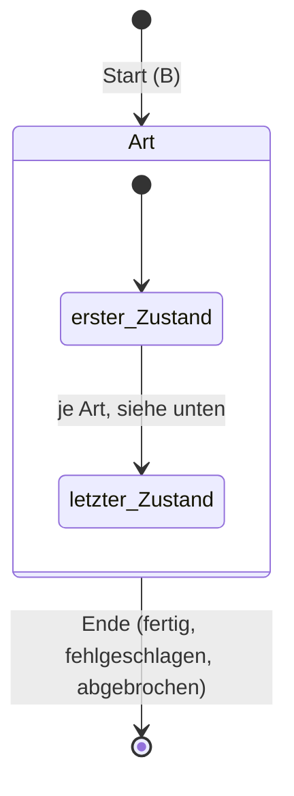
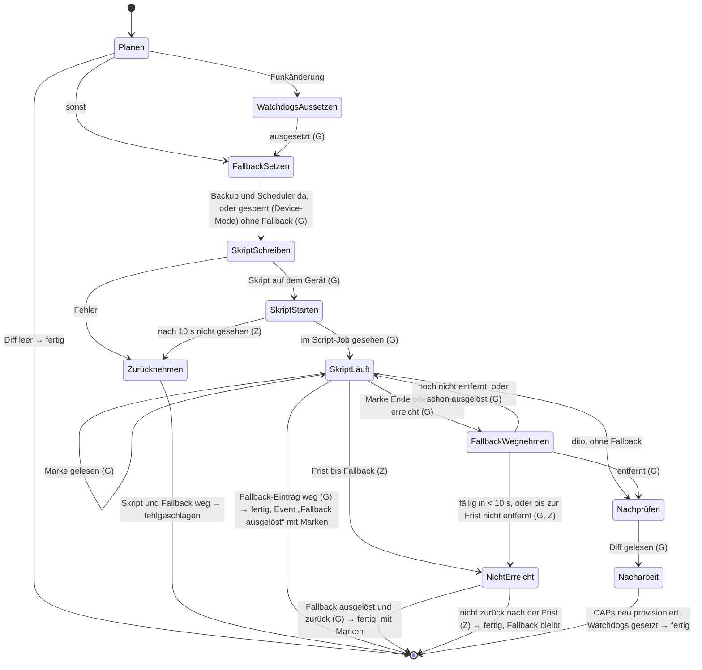
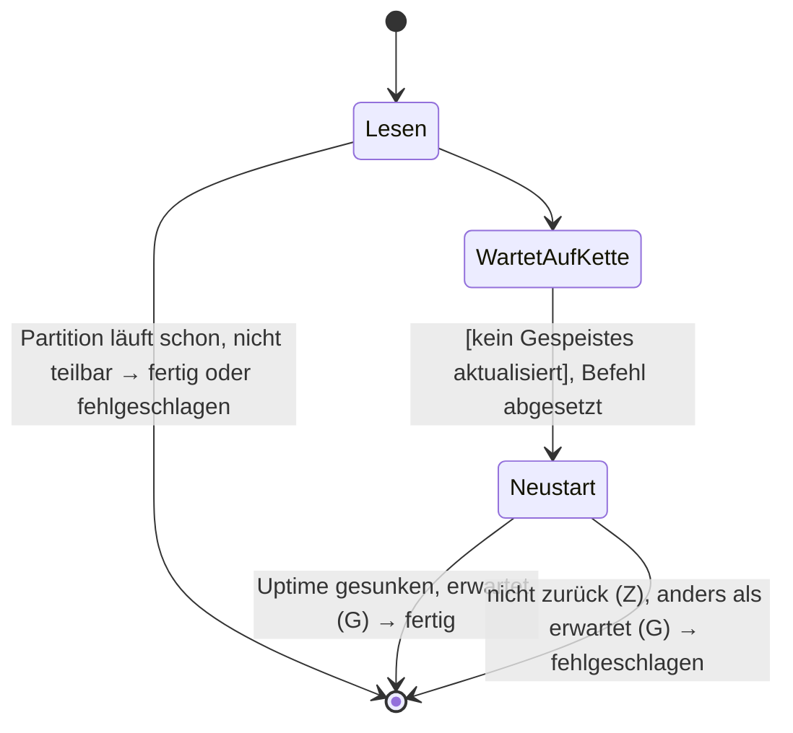
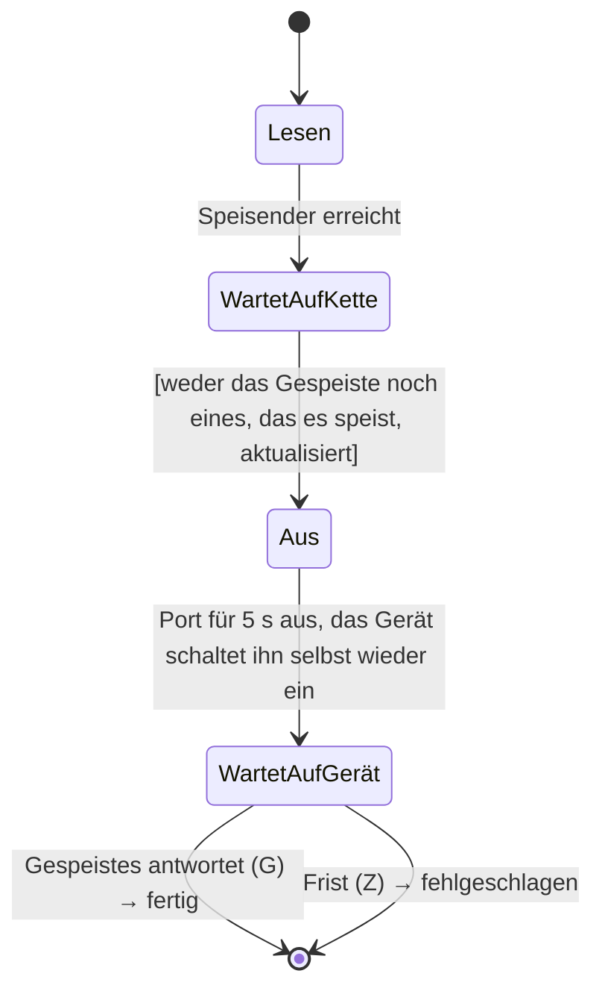

# Jobs und Gerätezustand

Ein Update, ein Anwenden, eine Ersteinrichtung, ein Neustart und die übrigen Aufträge an ein Gerät
laufen als **Jobs** (`backend::job`): Die Mutation gibt den Job sofort zurück, die Arbeit läuft im
Hintergrund und meldet typisierte Events (`job::Event`), die das Frontend auf Deutsch zeigt
(`components/job.rs`, `i18n::job`). Ein Gerät hat höchstens einen Job zur Zeit; ein Job einer
Site (`SiteDiff`) liest nur und sperrt keines ihrer Geräte. Jede Art hat eine State-Machine
(`backend::device_state`), die sagt, welcher Zustand auf welchen folgen darf, was Abbrechen in
einem Zustand tut und was ein Neustart des Servers mit dem Job macht.

## Verfolgen im Browser

- `components/job.rs` fragt jede Sekunde `job(id) { events(after) }` (POST mit dem Bearer-Token;
  eine Subscription bräuchte das Token über einen Websocket). Die Geräteseite nimmt einen
  laufenden Job auf (`jobs(deviceId)`).
- **Server weg:** Schlägt die Abfrage fehl, zeigt die Ansicht eine Zeile und fragt seltener
  weiter (`RETRY`), statt jede Sekunde einen neuen Fehler zu zeigen.
- **Server neu gestartet:** Die Nummern der Jobs beginnen pro Lauf neu bei 1000 je Sekunde des
  Startzeitpunkts (`job::first_id`, modulo 1 000 000 Sekunden, passt in GraphQL' `Int`). Eine
  Nummer aus einem früheren Lauf findet so keinen fremden Job, sondern `null`: Die Ansicht zeigt
  den Job als unterbrochen (`JobMessage::Lost`, bei Anwenden und Update mit dem Hinweis auf den
  Fallback) und gibt die Seite frei.
- Ein Panic in der Arbeit eines Jobs beendet ihn als fehlgeschlagen mit `PANIC`.
- `cancelJob` setzt ein Flag, das die Arbeit zwischen den Schritten (`Log::check`) und beim Warten
  (`Log::unless_cancelled`) prüft.
- Die Ansicht zeigt den Zustand (`Job.phase`): „Stand: …“, solange der Job läuft, „Endete in: …“
  nach einem Fehler oder Abbruch, mit den Namen dieser Datei (`i18n::job::phase`).

## Grundsätze

1. **Beobachten ist automatisch, Reparieren nicht.** Der Provisioner darf jederzeit lesen. Etwas
   am Gerät ändern darf nur ein Mensch oder der Auftrag, den ein Mensch gestartet hat, auch wenn er
   nach einem Neustart weiterläuft.
2. **Übergänge kommen von Bedienung, Beobachtung oder Zeit.** In den Diagrammen steht die Quelle:
   **(B)** Bedienung, **(G)** Beobachtung am Gerät, **(Z)** Frist abgelaufen. Eine Bedingung über
   andere Geräte steht in eckigen Klammern, z.B. `[kein Speisendes startet neu]`.
3. **Den Zustand melden, bevor die Wirkung beginnt:** erst „Fallback wird gesetzt“, dann den
   Scheduler anlegen. Die Arbeit meldet jeden Zustand (`Log::enter`); ein Übergang, den die Tabelle
   nicht erlaubt, wird als `unexpected state` geloggt und behalten (`Log::unexpected`, in den
   Batch- und CHR-Tests leer verlangt), der Job läuft unverändert weiter.

## Zustände eines Jobs

Jede Art (`JobKind`) ist eine eigene State-Machine; gemeinsam ist nur der Rahmen:

Für jede Art gilt:
- **Start** ist immer eine Bedienung (B). Was beim Start schon entschieden ist, gehört zum Start
  und ist kein Zustand: die Version eines Updates, „ohne Weg zurück bestätigt“ (Z23), die MAC der
  Ersteinrichtung.
- **Ende** ist einer von drei Ausgängen (fertig, fehlgeschlagen, abgebrochen); der Zustand, in
  dem der Auftrag endete, bleibt bei ihm.
- **Abbrechen** (B) wirkt nur in Zuständen, die es erlauben (in den Diagrammen *abbrechbar*); in
  den anderen läuft der Zustand zu Ende, dann gilt der Abbruch.
- **Server gestartet**: Für jeden Zustand steht fest, was dann geschieht: *weiterführen* (nur
  wo das Ende eine gelungene Änderung zurücknähme, siehe
  [Weiterführen](#weiterführen-nach-einem-neustart)) oder *unterbrochen* (Ende; was der Auftrag
  auf dem Gerät gesetzt hat, bleibt dort).
- **Auf dem Gerät** sagt die Tabelle jeder Art, was ein Zustand dort hinterlegt (+) oder
  wegnimmt (−) und was von selbst wirkt, wenn niemand es vorher wegnimmt.

Die Übergänge sind mit ihrer Quelle bezeichnet: **(B)** Bedienung, **(G)** Beobachtung am Gerät,
**(Z)** Frist abgelaufen. Eine Bedingung über andere Geräte steht in eckigen Klammern, z.B.
`[kein Speisendes startet neu]`.

### Anwenden

**Wofür:** bringt die Konfiguration des Geräts auf das, was der Generator aus NetBox erzeugt
(`applyCfg`). Was danach im Diff übrig bleibt, ist das, was nicht ging.

**Beachtet:**
- Das Skript läuft **auf dem Gerät** im Hintergrund, damit es fertig wird, auch wenn es den Weg
  der Verbindung ändert. Es hält beim ersten Fehler an.
- Vorher sichert das Gerät ein Backup und plant dessen Laden (Skript-Limit 120 s plus
  `apply_fallback_seconds`). Das Ende des Skripts zieht den Fallback auf die Frist ab dann vor.
- Gezählt wird nach der **Uptime** des Geräts, nicht nach seiner Uhr: Ein NTP-Sprung nach dem
  Anwenden liess einen Fallback sofort fällig aussehen (1og-sw1).
- Das Skript schreibt **Marken** unter `flash/` (Menü begonnen, Ende oder Fehlerzeile, Ping zum
  Provisioner weg/zurück). Sie überdauern den Neustart des Fallbacks und sagen, wo es abriss.
- Innerhalb von 10 s vor dem Auslösen wird der Fallback nicht mehr weggenommen (`DUE`).
- Eine Funkänderung verlängert die Frist um 24 min (DFS-Kanäle hören vorher auf Radar) und setzt
  die Watchdogs der abhängigen Geräte aus.
- Jede Prüfung nach dem Skript hat 25 s, damit eine kurz wieder offene Funkstrecke nicht
  verpasst wird.
- Sperrt der Device-Mode den Scheduler, geht es ohne Fallback (`FallbackUnavailable`).
- Ändert das Anwenden die WLANs eines Controllers, provisioniert es danach die CAPs neu.

**Bewusst nicht:**
- Ein gestartetes Skript wird nie angehalten, auch nicht beim Abbrechen; das entscheidet der
  Mensch.
- Ein Gerät ohne Marken (Datei nicht schreibbar) gilt nach 90 s als durch, wie vor den Marken.
- Die Reihenfolge eines Rollouts (vom Management-Proxy nach aussen, z.B. bei MTU) ist Sache des
  Menschen, nicht des Auftrags.

`device_state::ApplyState` (Name im Code in Klammern); das einzelne und das gemeinsame
Anwenden melden ihre Zustände daran. Die Watchdogs werden **vor** dem Fallback ausgesetzt;
„zurückgeladen“ ist kein Zustand, sondern ein Ende (der Auftrag liest die Marken und endet).

| Zustand | abbrechbar | Server gestartet | auf dem Gerät |
|---|---|---|---|
| `Planen` (`Planning`) | ja, Ende | unterbrochen | – |
| `WatchdogsAussetzen` (`SuspendingWatchdogs`) | ja, Watchdogs zurück | unterbrochen | + Sicherheitsnetz (bei den Überwachenden) |
| `FallbackSetzen` (`ArmingFallback`) | ja, Fallback weg | unterbrochen, Fallback beobachten | + Apply-Fallback |
| `SkriptSchreiben` (`WritingScript`) | ja, Fallback weg | unterbrochen | – |
| `SkriptStarten` (`StartingScript`) | nach dem Zustand | unterbrochen | + Apply-Skript |
| `Zurücknehmen` (`TakingBack`) | nach dem Zustand | unterbrochen | − Apply-Fallback |
| `SkriptLäuft` (`ScriptRunning`) | ja, Fallback bleibt | weiterführen | – |
| `FallbackWegnehmen` (`StoppingFallback`) | nach dem Zustand | weiterführen | − Apply-Fallback |
| `NichtErreicht` (`NotReached`) | ja, Fallback bleibt | unterbrochen | – |
| `Nachprüfen` (`Checking`) | ja, Ende | unterbrochen | – |
| `Nacharbeit` (`Finishing`) | nach dem Zustand | unterbrochen | − Sicherheitsnetz |

**Gemeinsam anwenden** ist ein Anwenden pro Gerät, deren Machines über Bedingungen aufeinander
warten (siehe [Bedingungen über Geräte hinweg](#bedingungen-über-geräte-hinweg)).

### Update

**Wofür:** bringt RouterOS auf den neuesten Stand des gewählten Kanals, die Pakete auf das, was
NetBox braucht, und danach die RouterBOARD-Firmware (`updateRouteros`).

**Beachtet:**
- RouterOS 6 geht zuerst auf das neueste v6, dann auf v7.
- Pakete: `routeros` plus das Funkpaket, das NetBox braucht; `wireless` bleibt, wo ein
  Legacy-CAPsMAN läuft, den NetBox nicht kennt. Alles andere wird deinstalliert.
- Alle Pakete eines Schritts werden heruntergeladen, bevor das erste hochgeht, und entfernt,
  wenn der Auftrag vor dem Neustart endet: ein Teil davon darf nicht irgendwann installieren.
- Hochladen über SCP; dafür wird `/ip ssh` kurz auf Passwort-Login gestellt. Danach wird die
  Grösse geprüft (16-MB-Geräte haben den Root im RAM).
- Ein Neustart gilt als erkannt, wenn die Uptime sinkt, nicht wenn die Verbindung abreisst.
- **Erfolg** heisst: erwartete Version *und* alle OSPF-Nachbarn von vorher wieder benachbart
  (`Full`, oder `TwoWay` zwischen zwei DROther).
- Fallback: die alte Partition samt Konfiguration kopieren, ein Scheduler bootet sie, wenn der
  Auftrag sie nicht rechtzeitig wegnimmt.
- Die Watchdogs der Geräte, die dieses überwachen, werden ausgesetzt; ihr Sicherheitsnetz setzt
  sie nach 2 h selbst wieder.
- PoE-Kette: siehe [Bedingungen](#poe-kette).
- Alte Geräte: MD5-Login vor 6.43, v6-SSH-Algorithmen, Board-Namen ohne `RB`.

**Bewusst nicht:**
- Für die Firmware gibt es keinen Weg zurück (nur der Backup-Booter vor Ort).
- RouterOS 6 und Geräte ohne zwei Partitionen haben keinen Fallback; das bestätigt der Mensch
  beim Start (Z23).
- Updates, die nicht dieser Provisioner startet, sieht die PoE-Kette nicht.

`device_state::UpdateState`, zusammen mit dem Downgrade (Name im Code in Klammern).

```mermaid
stateDiagram-v2
    [*] --> Lesen
    Lesen --> WatchdogsAussetzen: Überwachende vorhanden, bestätigt
    Lesen --> WartetAufKette: sonst
    WatchdogsAussetzen --> WartetAufKette
    WartetAufKette --> NachbarnMerken: [kein Speisendes startet neu], Schritt nötig
    WartetAufKette --> Firmware: [kein Speisendes startet neu], RouterOS und Pakete stimmen, Firmware alt
    WartetAufKette --> [*]: dito, Firmware aktuell → fertig
    NachbarnMerken --> FallbackSetzen
    FallbackSetzen --> Laden: alte Partition kopiert, Scheduler da, oder ohne Weg zurück bestätigt (G)
    Laden --> Hochladen: alle Pakete des Schritts heruntergeladen
    Hochladen --> WartetAufNeustart: alle Pakete auf dem Gerät (G)
    WartetAufNeustart --> Neustart: [kein Gespeistes aktualisiert]
    Neustart --> Laden: Version richtig, weiterer Schritt (v6 → v7) (G)
    Neustart --> FallbackWegnehmen: Version richtig, letzter Schritt (G)
    Neustart --> NachbarnWarten: dito, ohne Fallback (RouterOS 6)
    FallbackSetzen --> NichtAktualisiert: Fehler
    Laden --> NichtAktualisiert: Fehler, Abbruch
    Hochladen --> NichtAktualisiert: Fehler, Abbruch → Pakete weg
    WartetAufNeustart --> NichtAktualisiert: Abbruch → Pakete weg
    Neustart --> NichtAktualisiert: alte Partition läuft, nicht zurück (Z), andere Version (G)
    NichtAktualisiert --> [*]: fehlgeschlagen; zurückgerollt, oder erreicht und Fallback weg
    FallbackWegnehmen --> NachbarnWarten
    NachbarnWarten --> Firmware: alle gemerkten Nachbarn benachbart, Firmware alt (G)
    NachbarnWarten --> [*]: dito, Firmware aktuell → fertig; Frist (Z) → fehlgeschlagen
    Firmware --> WartetAufFirmwareNeustart: Upgrade gesetzt
    WartetAufFirmwareNeustart --> FirmwareNeustart: [kein Gespeistes aktualisiert]
    FirmwareNeustart --> [*]: neue Firmware läuft (G) → fertig
```

Nach jedem Zustand, auch nach einem Fehler: `WatchdogsZurück` (`RestoringWatchdogs`), wo
welche ausgesetzt sind. Ohne Fallback (kein Weg zurück) gibt es `NichtAktualisiert` nicht: Ein
Fehler endet direkt.

| Zustand | abbrechbar | Server gestartet | auf dem Gerät |
|---|---|---|---|
| `Lesen` (`Reading`) | ja, Ende | unterbrochen | – |
| `WatchdogsAussetzen` (`SuspendingWatchdogs`) | nach dem Zustand | unterbrochen | + Sicherheitsnetz (bei den Überwachenden) |
| `WartetAufKette` (`WaitingForChain`), `NachbarnMerken` (`RememberingNeighbors`) | ja, Ende | unterbrochen | – |
| `FallbackSetzen` (`ArmingFallback`) | nach dem Zustand | unterbrochen, Fallback beobachten | + Update-Fallback |
| `Laden` (`Downloading`) | ja, Fallback weg | unterbrochen | – |
| `Hochladen` (`Uploading`), `WartetAufNeustart` (`WaitingToReboot`) | ja, Pakete und Fallback weg | unterbrochen, Pakete beobachten | + Pakete |
| `Neustart` (`Rebooting`) | nach dem Zustand | weiterführen, wenn ein Fallback gesetzt ist | − Pakete (installiert) |
| `NichtAktualisiert` (`NotUpdated`) | nach dem Zustand | weiterführen | − Update-Fallback, wenn erreicht |
| `FallbackWegnehmen` (`StoppingFallback`) | nach dem Zustand | weiterführen | − Update-Fallback |
| `NachbarnWarten` (`WaitingForNeighbors`) | ja, Ende | unterbrochen | – |
| `Firmware`, `FirmwareNeustart` (`RebootingFirmware`) | nach dem Zustand | unterbrochen | – |
| `WartetAufFirmwareNeustart` (`WaitingToRebootFirmware`) | ja, Ende | unterbrochen | – |
| `WatchdogsZurück` (`RestoringWatchdogs`) | nach dem Zustand | unterbrochen | − Sicherheitsnetz |

Die Watchdogs, die das Gerät überwachen, setzt der Auftrag vor dem Warten auf die Kette auf den
**anderen** Geräten aus (`Watchers`) und danach wieder; ihr Sicherheitsnetz liegt bei **jenen**
Geräten. Ein Fehler mit gesetztem Fallback ist ein eigener Zustand (`not_updated`): Er erkennt,
ob das Gerät zurückgerollt ist, und nimmt sonst den Fallback weg.

### Downgrade

**Wofür:** die Rettung nach einem Update, das zwar läuft, aber Probleme macht: dieselben Pakete
in einer älteren Version (`downgradeRouteros`), vorbelegt mit der Version vor dem letzten Update.

**Beachtet:**
- Hochladen wie beim Update, dann `/system/package/downgrade`, das selbst neu startet.
- Auf die andere Partition wird nichts kopiert: Sie hält vielleicht genau den Weg zurück.
- Ein Gerät ohne zwei Partitionen braucht die Bestätigung beim Start (`check_downgrade`).

**Bewusst nicht:** die Firmware zurückstellen.

Dieselbe Machine wie das Update, ohne Fallback und Firmware:

```mermaid
stateDiagram-v2
    [*] --> Lesen
    Lesen --> WatchdogsAussetzen: Überwachende vorhanden, bestätigt
    Lesen --> WartetAufKette: sonst
    Lesen --> [*]: keine ältere Version von RouterOS 7 → fehlgeschlagen
    WatchdogsAussetzen --> WartetAufKette
    WartetAufKette --> NachbarnMerken: [kein Speisendes startet neu]
    NachbarnMerken --> Laden: zweite Partition, Nachbar oder bestätigt
    NachbarnMerken --> [*]: kein Weg zurück → fehlgeschlagen
    Laden --> Hochladen
    Hochladen --> WartetAufNeustart: Pakete auf dem Gerät (G)
    WartetAufNeustart --> Neustart: [kein Gespeistes aktualisiert], Downgrade ausgelöst
    Neustart --> NachbarnWarten: ältere Version läuft (G)
    Neustart --> [*]: abgelehnt → Pakete weg; nicht zurück (Z) → fehlgeschlagen
    NachbarnWarten --> [*]: Nachbarn da (G) → fertig
```

Auf dem Gerät: Pakete ab `Hochladen`, weg mit dem `Neustart`.

### Neustart, Partitionieren, Partition booten

**Wofür:**
- **Neustart:** „Neu starten“ auf der Geräteseite, mit Rückfrage (`rebootDevice`).
- **Partitionieren:** teilt den Flash in zwei Partitionen, die Voraussetzung für den Fallback
  des Updates (`repartitionDevice`; ab RouterOS 7.20, mindestens 128 MiB, Device-Mode
  `partitions`).
- **Partition booten:** startet von der anderen Partition, z.B. zurück auf die vor dem Update
  (`bootPartition`).

**Beachtet:** Alle drei warten wie ein Update auf die PoE-Kette und erkennen den Neustart an der
Uptime.

**Bewusst nicht:** ein Kaltstart; dafür gibt es „Strom aus und ein“.

`device_state::RebootState`:

„Erwartet“ heisst beim Partitionieren zwei Partitionen und dieselbe Identity, beim Booten die
gewählte Partition. Abbrechbar bis `WartetAufKette`; nach einem Start des Servers: unterbrochen.

### Strom aus und ein

**Wofür:** startet ein über PoE gespeistes Gerät kalt (`powerCycle`): ein hängendes Gerät, oder
die Bestätigung einer Device-Mode-Änderung, die ein warmer Neustart nicht gibt.

**Beachtet:**
- Der Port des Speisenden wird über seinen Werksnamen gefunden und 5 s ausgeschaltet.
- Ein Auftrag des Speisenden, damit er neben dem eigenen Auftrag des Geräts laufen kann (die
  Device-Mode-Änderung wartet ja gerade auf ihn).
- Er wartet, solange das Gerät oder eines, das es speist, Pakete installiert.

**Bewusst nicht:** Der Provisioner startet ihn nie von selbst.

Ein Auftrag des **Speisenden**, der den Strom eines anderen Geräts schneidet. Beim gespeisten
Gerät ist dafür kein eigener Zustand nötig: Ob ihm gerade der Strom geschnitten wird, folgt aus
dem Auftrag seines Speisenden.

`device_state::PowerCycleState`:

Die Bedingung `[kein Speisendes startet neu]` gilt für das Gespeiste bis zum Ende von
`WartetAufGerät`, nicht nur bis zum Befehl: Der Port ist noch aus, wenn der Befehl zurückkommt.

### Device-Mode

**Wofür:** schaltet Features ein, die der Provisioner braucht und die der Device-Mode sperrt
(`changeDeviceMode`): den Scheduler für den Apply-Fallback, `/ip socks` auf dem Gerät des
Management-Proxys, `partitions` für den Update-Fallback.

**Beachtet:**
- RouterOS übernimmt die Änderung nur nach einer Bestätigung **am Gerät** (Taste oder Kaltstart)
  innerhalb von 10 min; ein warmer Neustart bestätigt nicht.
- Die Verbindung muss offen bleiben, solange das Gerät zählt; schliesst sie, bricht RouterOS ab.
- Gesendet werden nur Features, die aus sind: Auch eine Änderung ohne Wirkung zählt herunter.

**Bewusst nicht:** andere Features des Device-Mode.

`device_state::DeviceModeState`:

```mermaid
stateDiagram-v2
    [*] --> Lesen
    Lesen --> [*]: alles schon an → fertig
    Lesen --> WartetAufKette: Features fehlen
    WartetAufKette --> Anfordern: [kein Gespeistes aktualisiert]
    Anfordern --> WartetAufTaste: Update gesendet, Gerät zählt (G)
    Anfordern --> [*]: abgelehnt (G) → fehlgeschlagen
    WartetAufTaste --> Neustart: Gerät geht weg (G) — Taste oder Kaltstart (B am Gerät)
    WartetAufTaste --> [*]: „update canceled“ nach 10 min (Z) → fehlgeschlagen
    Neustart --> [*]: Features an (G) → fertig; Frist (Z) → fehlgeschlagen
```

Die Bestätigung ist eine Bedienung **am Gerät**, nicht im Provisioner; der Auftrag beobachtet nur,
dass das Gerät weggeht. `WartetAufTaste` hält die Verbindung offen, sonst bricht RouterOS ab:
Nach einem Start des Servers ist die Änderung deshalb sicher weg, also *unterbrochen*, und
nichts bleibt liegen. Auch `Neustart` endet als unterbrochen: er liest nur.

### Ersteinrichtung

**Wofür:** richtet ein Gerät ein, das nicht antwortet (Werkszustand, verlorene Adresse), über
`/tool mac-telnet` von einem Nachbarn aus, der antwortet (`bootstrap`): Passwort, Adresse, API,
eine Firewall-Freigabe.

**Beachtet:**
- Das Gerät wird über die MAC gewählt, die der Nachbar an diesem Port sieht oder die der Mensch
  eintippt, **nie über eine MAC aus NetBox**.
- Die Konsole des Nachbarn läuft über SSH; vorher wird geprüft, dass er SSH-Weiterleitung
  erlaubt, sonst bleibt alles unberührt.
- `mac-telnet` mit und ohne `interface=` (je nach Gerät antwortet nur eine Variante).
- Ein spät antwortendes Gerät lässt Logins scheitern oder Sitzungen abbrechen: Jede Anmeldung
  wird bis zu einer Frist wiederholt, nach einem Abbruch laufen alle Befehle noch einmal (jeder
  tut nichts, wo er schon gilt).
- Endet die Sitzung früh, landen Befehle auf der Konsole des Nachbarn; jeder Befehl tut dort
  nichts (`netboxProvisionerNeighbor`).
- Ein DHCP-Client, der die Adresse hält, wird ausgeschaltet; der CAP eines Heim-APs nur nach
  einem Werks-Login.

**Bewusst nicht:** die eigentliche Konfiguration; die bringt das erste Anwenden.

`device_state::BootstrapState`:

```mermaid
stateDiagram-v2
    [*] --> NachbarPrüfen: [Nachbar ohne Auftrag]
    NachbarPrüfen --> [*]: Weiterleitung aus → fehlgeschlagen
    NachbarPrüfen --> Konsole: SSH zum Nachbarn, mac-telnet (G)
    Konsole --> WartetAufApi: Einrichtung durch (G); Logins bis zur Frist wiederholt
    Konsole --> [*]: kein Login bis zur Frist (Z) → fehlgeschlagen
    WartetAufApi --> [*]: API antwortet (G) → fertig
    WartetAufApi --> [*]: Frist (Z) → fehlgeschlagen
```

Läuft über ein anderes Gerät (den Nachbarn), das solange keinen eigenen Auftrag annimmt
(`job::start_through`): eine Bedingung über Geräte hinweg, und umgekehrt kein Auftrag des
Nachbarn, solange die Ersteinrichtung läuft. In `Konsole` nicht abbrechbar; nach einem Start des
Servers ist die Sitzung weg, also *unterbrochen*. Beim Nachbarn bleibt danach nur die globale
Variable `netboxProvisionerNeighbor` stehen, bis zur nächsten Ersteinrichtung über ihn oder
seinem nächsten Neustart; sie wirkt nur auf die Befehle der Einrichtung.

### Aufräumen

**Wofür:** räumt weg, was ein Auftrag auf dem Gerät liegen gelassen hat
([Liegengebliebenes](#was-auf-dem-gerät-liegen-bleibt),
`clearLeftover`): Fallback stoppen oder jetzt laden, Update-Fallback stoppen, Watchdogs jetzt
wiederherstellen, Pakete entfernen.

**Beachtet:** Nichts davon geschieht von selbst; ein schon weggeräumter Eintrag ist ein Fehler
(`LEFTOVER_GONE`), kein stilles Nichtstun.

**Bewusst nicht:** das Apply-Skript, solange es läuft (es endet selbst), und eine
Device-Mode-Änderung (die bleibt nie liegen).

`device_state::CleanupState`: `Wegräumen` (`Clearing`), dann Ende; „Jetzt zurück“ hat danach
`Neustart` (`Rebooting`), bis das Gerät mit der Konfiguration von vorher zurück ist, und davor
`WartetAufKette` (`WaitingForChain`), `[kein Gespeistes aktualisiert]` wie bei jedem Neustart.

### NetBox schreiben, zurücknehmen

**Wofür:** schreibt den Plan eines Helfers nach NetBox (`writeNetboxPlan`) oder nimmt ein solches
Schreiben zurück (`undoNetboxWrite`).

**Beachtet:**
- Der Plan wird neu berechnet und abgelehnt, wenn sein Fingerabdruck sich geändert hat; vor jedem
  Schritt wird geprüft, dass NetBox noch so ist, wie der Plan es fand.
- Jedes geschriebene Objekt hält seine alten Werte, damit Rückgängig sie rückwärts wieder setzt;
  Gelöschtes wird neu angelegt (mit neuer Id).
- Jede Änderung trägt eine Changelog-Nachricht mit Plan und Benutzer; danach wird die Topologie
  neu gelesen.

**Bewusst nicht:** eine Transaktion. NetBox hat keine über mehrere Objekte, ein Fehler mitten im
Plan lässt den Teil davor geschrieben (`poe_type` an koenig-hegglin).

`device_state::NetboxState`: `Planen` (`Planning`, Plan neu berechnet und mit dem gezeigten
verglichen), `Schreiben` (`Writing`, Schritt um Schritt) bzw. `Zurücknehmen` (`Undoing`), danach
in jedem Fall `NeuLesen` (`Refetching`, die Topologie). Nach einem Start des Servers:
unterbrochen; was durchging, bleibt in NetBox, das Rückgängig dazu ist weg (es lebt in den Events
des Jobs).

## Bedingungen über Geräte hinweg

Zwei Dinge hängen an den Aufträgen **mehrerer** Geräte. Sie sind keine Zustände, sondern
Bedingungen an Übergängen, in eckigen Klammern in den Diagrammen.

### PoE-Kette

Ein Gerät, das gerade Pakete auf dem Flash hat, kann ein Stromausfall unbrauchbar machen. Das
verhindern die Leases in `device::power` (nur im Prozess); als Bedingungen:

| Bedingung | wahr, wenn kein Gerät der Kette … |
|---|---|
| `[kein Gespeistes aktualisiert]` | … unterhalb (das es direkt oder weiter unten speist) in einem Update oder Downgrade nach `WartetAufKette` ist |
| `[kein Speisendes startet neu]` | … oberhalb neu startet (`Neustart`, `Ausgelöst`, `FirmwareNeustart`, Device-Mode `WartetAufTaste` und `Neustart`) oder einem Gerät darunter den Strom schneidet („Strom aus und ein“ `Aus`, `WartetAufGerät`) |
| `[weder das Gespeiste noch eines, das es speist, aktualisiert]` | … ab dem gespeisten Gerät abwärts in einem Update oder Downgrade nach `WartetAufKette` ist |

Wer auf eine Bedingung wartet, bleibt im Zustand `WartetAuf…`; der Übergang geschieht, sobald ein
anderes Gerät seinen Lease freigibt. Prüfen und Nehmen geschehen unter einer Sperre, damit sich
zwei Geräte nicht kreuzen. Die Leases halten nur Neustarts zurück, die der Provisioner sendet,
nicht einen Watchdog ([Watchdog](watchdog.md#updates)).

### Gemeinsam anwenden

**Wofür:** wendet mehrere Geräte zusammen an (`applyBatch`), vor allem beide Enden einer
Funkstrecke: Einzeln geändert schneidet das erste Ende dem zweiten den Weg ab.

**Beachtet:**
- Ein Fallback für alle, der im selben Moment auslöst; jedes Skript zieht seinen auf etwa
  denselben Zeitpunkt vor.
- Die Skripte starten gleichzeitig und beginnen mit `:delay 15s`, damit jeder Start durchkommt,
  bevor die ersten Änderungen eine Verbindung kappen. Nacheinander gestartet schnitt im Lab der
  AP der 60-GHz-Strecke die Station ab, bevor ihr Skript lief.
- Die Fallbacks gehen nur weg, wenn **jedes** Gerät erreicht und durch ist; sonst laden alle
  zusammen ihre Konfiguration von vorher.
- Abbrechen eines Geräts bricht alle ab.

**Bewusst nicht:** Teilerfolg. Lieber alles zurück als eine halbe Funkstrecke.

Ein Anwenden pro Gerät, alle mit Verweis auf die Gruppe. Drei Übergänge haben eine Bedingung über
die Gruppe:

| Übergang | Bedingung |
|---|---|
| `Planen → FallbackSetzen` (oder `WatchdogsAussetzen`) | `[alle Geräte der Gruppe haben geplant]`; das Aussetzen geschieht eins nach dem anderen |
| `SkriptSchreiben → SkriptStarten` | `[alle haben ihr Skript geschrieben]`, dann starten alle gleichzeitig |
| `SkriptLäuft → FallbackWegnehmen` | `[alle sind durch, erreicht und in Reihe]`, sonst gehen alle nach `NichtErreicht` (`BatchIncomplete`) und der Auftrag endet dort, ohne auf den Fallback zu warten. Nachgeprüft wird schon in `SkriptLäuft`, nach `FallbackWegnehmen` folgt direkt `Nacharbeit` |

Ein Fehler eines Geräts vor dem Start nimmt bei allen den Fallback weg (`BatchStopped`).

## Weiterführen nach einem Neustart

Gespeichert wird nur, was ein Auftrag braucht, um nach einem Neustart des Servers weiterzulaufen.
Alles andere – die übrigen Aufträge, ihre Events, das Rückgängig eines NetBox-Schreibens – lebt nur
im Speicher des Prozesses. Was ein unterbrochener Auftrag auf dem Gerät gelassen hat, findet die
Geräteseite danach [dort](#was-auf-dem-gerät-liegen-bleibt).

Weitergeführt werden nur die Zustände, in denen das Unterbrechen eine gelungene Änderung
zurücknähme. Alle anderen warten oder lesen nur und enden als unterbrochen (`Restart`):

| Art | Zustände | was ohne Weiterführen geschähe |
|---|---|---|
| Anwenden, einzeln und gemeinsam | `SkriptLäuft`, `FallbackWegnehmen` | der Apply-Fallback lädt die Konfiguration von vorher |
| Update mit Fallback | `Neustart`, `NichtAktualisiert`, `FallbackWegnehmen` | der Update-Fallback bootet die alte Partition |

Pro weiterführbarem Auftrag eine Datei `state_dir/jobs/<netbox-id>.json`, geschrieben beim
Eintritt in einen dieser Zustände (temporär schreiben, dann umbenennen) und gelöscht, sobald der
Auftrag sie verlässt oder endet. Sie hält:

- **Anwenden:** Gerät, Zustand, ob ein Fallback gesetzt ist, den Lauf des Skripts (für die
  Marken), die Fristen (Aufgeben, Rückkehr nach dem Fallback) als Uhrzeit des Servers, die Menüs,
  deren CAPs neu provisioniert werden, und die ausgesetzten Watchdogs anderer Geräte (Gerät und
  was sie überwachen). Beim gemeinsamen Anwenden hat jedes Gerät seine Datei mit den Ids der
  ganzen Gruppe; weitergeführt wird die Gruppe zusammen.
- **Update:** Gerät, Zustand, Zielversion, Version vorher, die gewünschten Pakete, die Partition
  des Fallbacks, die gemerkten OSPF-Nachbarn, die Uptime vor dem Neustart mit der Uhrzeit des
  Befehls, und die ausgesetzten Watchdogs anderer Geräte.

Fristen sind Uhrzeiten des Servers: ein `Instant` gilt über einen Neustart nicht. Die Uhr des
Geräts bleibt aussen vor (sie springt nach einem Neustart, siehe 1og-sw1).

Beim Start:
1. Der Server hält `state_dir/lock`, solange er läuft; eine zweite Instanz mit demselben
   `state_dir` startet nicht.
2. Für jede Datei: Kennt NetBox das Gerät, startet ein Auftrag derselben Art im gespeicherten
   Zustand und meldet, dass er nach einem Neustart weiterläuft; von dort an läuft er wie sonst
   (beim Update auch die Firmware). Kennt NetBox es nicht mehr, bleibt die Datei; die
   Site-Auswahl zeigt sie, bis jemand sie verwirft (B). Ebenso eine Datei, die sich nicht lesen
   lässt.
3. Ein Update in `Neustart` schaut zuerst, ob das Gerät seit dem Eintritt gebootet hat
   (frühestens 30 s danach, ein eben gesendeter Neustart braucht so lange). Antwortet es mit
   älterer Uptime, kam der Server nicht mehr dazu, den Neustart zu senden: Der Auftrag endet
   sofort mit `REBOOT_NOT_SENT` statt erst nach der Frist. Pakete und Update-Fallback bleiben
   auf dem Gerät für die Geräteseite; der Auftrag startet das Gerät nicht selbst neu.

Im Code (`backend::saved_job`): Ein Job gibt seinem `Log` mit, was die Datei braucht
(`Log::keep`); `Log::enter` schreibt sie in einem weiterführbaren Zustand und entfernt sie in jedem
anderen, das Ende des Jobs ebenso. Dateien, die kein Job aufnimmt, zeigt die Site-Auswahl
(`savedJobs`, `discardSavedJob`). Ein weitergeführter Job beginnt mit dem Event `Resumed` und darf
seinen gespeicherten Zustand einmal neu betreten (`Log::resume_in`).

- **Anwenden** (`SavedApply`: Zugangsdaten nach Name, `ScriptRun`, gehaltene Watchdogs): verbindet,
  bis das Gerät antwortet (bis zur Frist für die Rückkehr nach dem Fallback), hält die Watchdogs
  wieder (`WatchdogSuspended` erneut, nicht erreichte bleiben dem Scheduler) und schaut auf die
  Marken wie vorher (`watch_script`). Mit Zugangsdaten ad hoc wird nichts gespeichert: Das Passwort
  gehört nicht in die Datei.
- **Gemeinsam anwenden** (`SavedBatch`: Geräte, Verzögerung der Fallbacks): weitergeführt nur, wenn
  alle Geräte gespeichert und in NetBox sind, dann zusammen nach denselben Regeln (`batch::watch`,
  jedes Gerät wieder erreicht, sobald es antwortet); sonst wartet jede Datei mit dem Grund
  (`HeldBack`), und die Fallbacks nehmen alles zurück.
- **Update** (`UpdateRun`, übergeben von `update::update_keeping`): wartet auf den Neustart, gezählt
  seit dem Eintritt in `Neustart`, prüft Version und Partition und macht wie sonst weiter (weitere
  Schritte, Fallback weg, Nachbarn, Firmware); in `NichtAktualisiert` entscheidet er über den
  Fallback erneut (`UPDATE_FAILED_BEFORE`). Die Watchdogs anderer Geräte meldet er gleich wieder als
  ausgesetzt und stellt sie am Ende wieder her.

## Beenden

Sobald die Server nach SIGTERM oder SIGINT keine Anfragen mehr nehmen (actix bis 30 s), ruft
`binary` `job::shutdown`: Ein Job mit geschriebener Datei bleibt, wie er ist (der Prozess endet
mitten im Warten, der Job geht nach dem Start weiter). Jeder andere wird abgebrochen und hat bis zu
20 s, zu enden oder einen weiterführbaren Zustand zu erreichen; endet er dabei in einem solchen
(ein Anwenden, abgebrochen beim Starten des Skripts), bleibt seine Datei. Die Jobs laufen dafür auf
einer eigenen Laufzeit (`job::RUNTIME`), nicht auf der von actix, die beim Beenden mit allem darauf
wegfällt. Die Gnadenfrist des Charts ist 60 s ([Deployment](deployment.md)).

## Was auf dem Gerät liegen bleibt

Was ein Job nicht zu Ende gesehen hat (abgebrochen, der Provisioner neu gestartet, das Gerät nicht
erreicht), zeigt die Geräteseite unter ihrem Kopf (`device::leftovers`,
`AccessibleDevice.leftovers`, `components::leftovers`; `null`, solange ein Job des Geräts läuft),
mit Knöpfen, die der Mensch auslöst. Jede Aktion ist ein Job `Cleanup` (`clearLeftover`); nichts
wird von selbst weggeräumt.

| Rest | von | Knöpfe |
|---|---|---|
| Apply-Fallback (Scheduler und Backup), mit der verbleibenden Zeit „laut Gerät“ (`next-run`; nach einem Sprung seiner Uhr stimmt sie nicht) | Anwenden, auch auf jedem Gerät eines gemeinsamen | „Fallback stoppen“ (die Änderung bleibt), „Jetzt zurück“ (das Skript des Eintrags mit `/execute`, dann warten, bis das Gerät zurück ist) |
| Update-Fallback (`netbox-provisioner-update-fallback`) | Update | „Fallback stoppen“ (das neue RouterOS bleibt) |
| Sicherheitsnetz der Watchdogs (`netbox-provisioner-watchdog`, setzt ausgesetzte Watchdogs nach 2 h selbst wieder; [Watchdog](watchdog.md)) | Update, Anwenden mit Funkänderung | „Jetzt wiederherstellen“ (`watchdog::restore` mit dem, was der Eintrag setzen würde) |
| `.npk`-Dateien im Root | Update, Downgrade | „Hochgeladene Pakete entfernen“ |
| das Skript `netbox-provisioner-apply`, nur solange es läuft | Anwenden | keiner, es endet von selbst |

- Das Apply-Skript bleibt nach jedem Anwenden liegen, das nächste ersetzt es; ein Rest ist es nur,
  solange es läuft.
- Pakete in einem Verzeichnis installiert RouterOS nicht; sie sind kein Rest und bleiben auch bei
  „Hochgeladene Pakete entfernen“ liegen. Ein CAPsMAN-Router hält dort mit Absicht die Pakete
  seiner CAPs (`sd1-part1/upgrade/…` auf einer SD-Karte).
- Hält den Eintrag des Sicherheitsnetzes der laufende Auftrag eines anderen Geräts (das Update des
  überwachten Geräts, ein Anwenden mit Funkänderung), ist er kein Rest: Die Seite zeigt ihn getrennt
  mit diesem Auftrag und ohne Knopf (`heldBy`), und `clearLeftover` lehnt ab (`LEFTOVER_HELD`), denn
  der Watchdog würde das Gerät neu starten, solange das andere weg ist.
- Eine Device-Mode-Änderung bleibt nie liegen: RouterOS bricht sie ab, wenn die Verbindung ihres
  Jobs schliesst.
- Ein schon weggeräumter Rest ergibt `LEFTOVER_GONE`, kein stilles Nichtstun.
- Geprüft auf CHR (`leftovers_are_found_and_cleared`): Jeder Rest wird gefunden und weggeräumt, und
  nach „Jetzt zurück“ hat das Gerät die Identity von vorher.

Was ein Job getan hat und wie weit er kam, steht im Journal des Geräts in NetBox, ebenso ein Rest
ohne Erklärung oder ein Fallback, der ohne Job ausgelöst hat ([Protokoll](protocol.md)).
